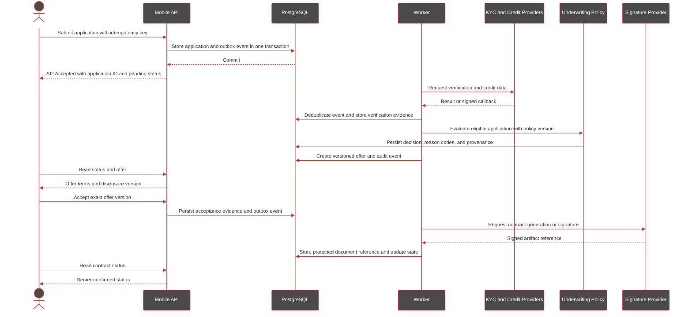
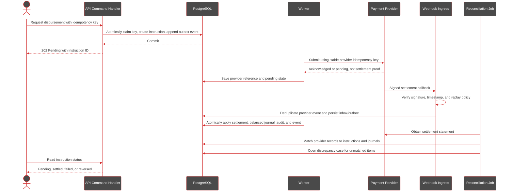
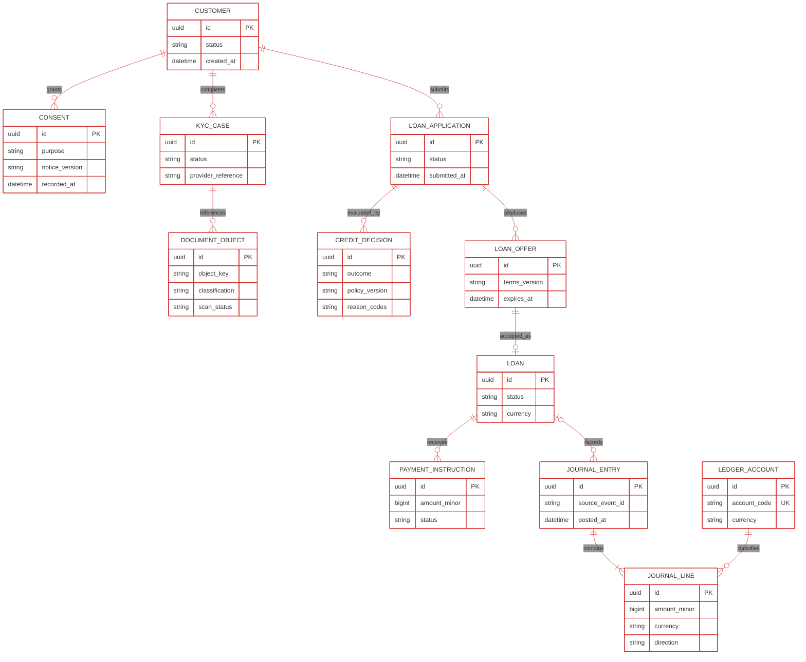
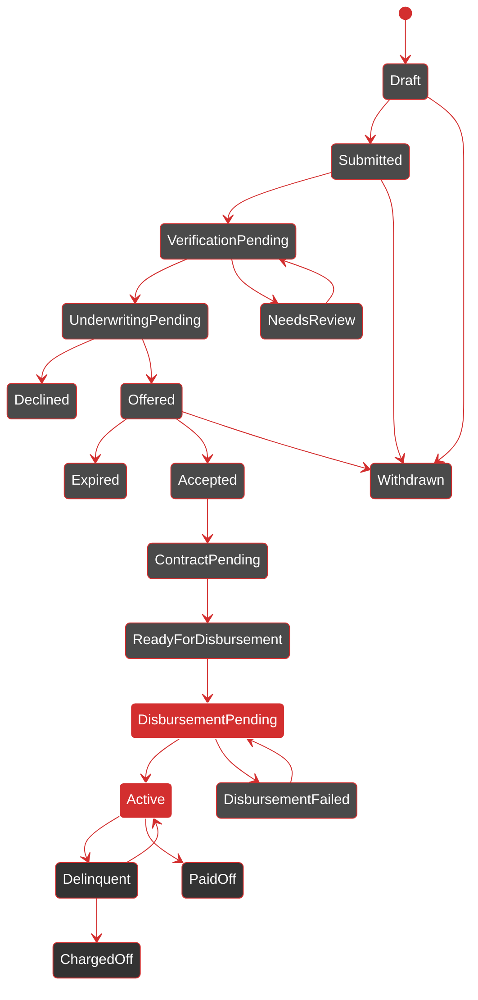
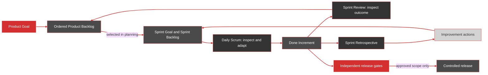
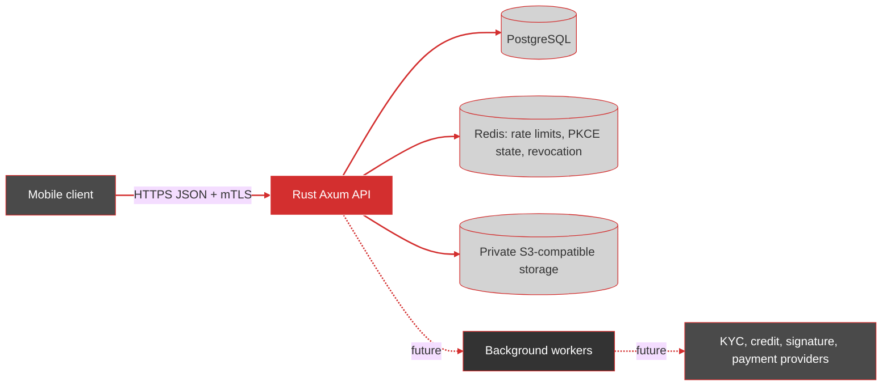

# Rho Studio Fintech Backend: Architecture and Delivery Plan

## Purpose and Constraints

This document defines the target backend that the repository is to implement. The product is **Rho Studio Fintech**, a mobile-first lending platform operating in Mexico. The lending operating model is not yet selected: Rho may originate and own loans, or a licensed partner may do so. The architecture must isolate that choice behind explicit policy and provider boundaries; it must not assume that software alone establishes regulatory authorization or compliance.

The backend is a Rust modular monolith initially, deployed as independently scalable API and worker processes from a shared, versioned application. PostgreSQL is the authoritative store for customer, loan, workflow, and accounting state. External systems are integrated through bounded adapters. Service decomposition is a later operational decision, not a prerequisite for domain separation.

### Product Goal

Deliver a secure, operable Rust backend for a Mexico-first mobile lending product. The first product increment supports a legally reviewed onboarding-to-offer journey and demonstrates financial correctness in a sandbox. Production lending and live money movement are separate releases requiring the release gates.

## Current Implementation Snapshot

This document combines the target architecture with a proposed delivery plan;
it is not a description of all currently running capabilities. The runtime
currently provides health/version, authentication for pre-provisioned users,
and consent notice/event routes. Consent transition policy is in
`src/domain/consent.rs`. Account, loan, and payment tables in `migrations/`
are schema groundwork only: no account, loan, repayment, transfer, ledger,
provider, or reconciliation workflow is exposed by the API. See
[banking-domain.md](banking-domain.md) for current gaps and domain invariants.

Do not use the target diagrams, state models, proposed capabilities, or backlog
items below as evidence that an endpoint, control, regulatory approval, or
financial operation is live. Update this snapshot only after implementation
and tests demonstrate the behavior.

The mobile requirements in `mobile-backend.md` apply to network resilience, compact APIs, authentication lifecycle, pagination, versioning, push, and diagnostics. Financial commands remain server-authoritative: offline clients may queue a request, but must not treat a loan decision, disbursement, or repayment as final until the server confirms it.

### Feature status

| Feature | Objective | Status |
| --- | --- | --- |
| F0 — Product and Regulatory Boundary | Resolve operating model, product catalog, and obligations register | In progress |
| F1 — Engineering Foundation | CI, environment separation, artifact provenance, boot sequence | Delivered |
| F2 — Identity, Authorization, and Security Baseline | Self-service auth, sessions, authorization, abuse controls | Substantially delivered; P0 gaps remain |
| F3 — Customer Profile, Consent, and Onboarding | Consent registry, KYC case flow, private evidence | Partially delivered; consent registry delivered, onboarding not wired |
| F4 — Loan Application | Draft-to-submission lifecycle | Not started |
| F5 — Underwriting and Decision Evidence | Versioned, reproducible decisions | Not started |
| F6 — Offer and Contract | Immutable, reviewable offer with acceptance evidence | Not started |
| F7 — Ledger and Financial Command Integrity | Balanced journal, idempotency, transfer state machine | Not started |
| F8 — Disbursement, Webhooks, and Reconciliation | Sandbox rails, verified callbacks, reconciliation | Not started |
| F9 — Loan Servicing and Repayment | Deterministic schedules, allocation, collections | Not started |
| F10 — Mobile API, Operations, and Compliance Evidence | Stable errors, push, observability, ARCO | Not started |

## Iteration Roadmap

Iterations are sequenced, not dated. Each is a two-week timebox. The team does not commit to calendar dates or velocity until the backlog is refined and historical capacity is known.

| # | Iteration Goal | Forecast outcome | Primary Feature | Gate target |
| --- | --- | --- | --- | --- |
| 1 | Align the product boundary and establish a running delivery skeleton | Approved MVP decisions and risk register; service builds, tests, and deploys to an isolated non-production environment | F0 | G0 |
| 2 | Establish the fintech foundation | CI gates, product identity, environment separation, boot sequence, error model | F1 | G1 |
| 3 | Secure customer identity and resource ownership | Token and session lifecycle, authorization policy, abuse limits, negative authorization tests | F2 | — |
| 4 | Harden identity: recovery, verification, and key management | Email verification, password reset, password strength, session listing, kid-based key rotation, PII redaction policy | F2 | — |
| 5 | Onboard a customer with approved consent and protected evidence | Consent registry, published notices, append-only evidence, customer-identity linkage | F3 | G2 |
| 6 | Complete identity verification | KYC case lifecycle, private document upload with quarantine and access audit | F3 | — |
| 7 | Submit and receive an auditable loan decision | Application lifecycle, required-data checklist, idempotent submission, versioned decision evidence with reason codes | F4, F5 | G3 |
| 8 | Present and accept a versioned offer safely | Immutable offer and disclosure references, acceptance evidence, signature sandbox | F6 | — |
| 9 | Prove ledger and command invariants without moving live money | Balanced journal posting, idempotency store, transfer state machine, simulator-driven ledger tests | F7 | G4 |
| 10 | Process provider outcomes and reconcile sandbox settlements | Signed and deduplicated webhook handling, retries, settlement matching, discrepancy cases | F8 | — |
| 11 | Service a loan with traceable repayment state | Schedule and allocation rules, payment states, customer history, reversals, collections controls | F9 | — |
| 12 | Demonstrate production readiness for a bounded pilot | Private production topology, restore and failure evidence, runbooks, exposure limits, kill switch | F10 | G5 |

## 1. Architecture Diagrams

These are the primary design views. The [system context and deployment diagram](architecture.mmd) defines trust zones and connectivity. The diagrams below define module ownership, critical behavior, core records, and the Scrum feedback loop. The prose that follows records constraints and decisions that are not obvious from a diagram.

| Palette token | Color | Diagram use |
| --- | --- | --- |
| `rho-red` | `#D32F2F` | Application identity, primary flow, active boundaries, and release gates |
| `rho-feature` | `#4A4A4A` | Mobile/client-facing applications and feature surfaces; white text |
| `rho-core` | `#333333` | Internal platform and domain components; white text |
| `rho-data` | `#D3D3D3` | Persistent infrastructure and data services; dark text |
| `rho-white` | `#FFFFFF` | Text and high-contrast boundaries on red/core/feature surfaces |

### Module and Data-Ownership View

```mermaid
%%{init: {"theme":"base","themeVariables":{"background":"#FFFFFF","mainBkg":"#FFFFFF","textColor":"#333333","lineColor":"#D32F2F"}}}%%
flowchart LR
	mobile[Mobile API] --> auth[Authentication and Authorization]
	webhooks[Verified Webhook Ingress] --> inbox[Webhook Inbox and Deduplication]

	subgraph services[Application Services]
		onboarding[Customer, Consent, KYC]
		lending[Application and Underwriting]
		contracts[Offer and Contract]
		servicing[Disbursement, Servicing, Collections]
	end

	auth --> onboarding
	auth --> lending
	auth --> contracts
	auth --> servicing
	inbox --> servicing

	subgraph financial_core[Financial Control Plane]
		idem[Idempotency]
		ledger[Immutable Ledger]
		audit[Audit and Compliance Evidence]
		outbox[Transactional Outbox]
		recon[Reconciliation]
	end

	onboarding --> audit
	lending --> audit
	contracts --> audit
	servicing --> idem
	servicing --> ledger
	servicing --> audit
	servicing --> outbox
	recon --> ledger

	subgraph adapters[Replaceable Provider Adapters]
		kyc[KYC and Credit]
		bank[Bank and Payment Rails]
		sign[Signature and Documents]
		notify[Push Notifications]
	end

	outbox --> kyc
	outbox --> bank
	outbox --> sign
	outbox --> notify

	subgraph stores[Persistence]
		pg[(PostgreSQL: authoritative state)]
		s3[(Private Object Storage)]
		redis[(Redis: disposable acceleration)]
	end

	onboarding --> pg
	lending --> pg
	contracts --> pg
	servicing --> pg
	idem --> pg
	ledger --> pg
	audit --> pg
	outbox --> pg
	recon --> pg
	onboarding --> s3
	contracts --> s3
	auth -.-> redis

	linkStyle default stroke:#D32F2F,stroke-width:2px
	classDef rhoRed fill:#D32F2F,stroke:#FFFFFF,color:#FFFFFF
	classDef rhoFeature fill:#4A4A4A,stroke:#D32F2F,color:#FFFFFF
	classDef rhoCore fill:#333333,stroke:#D32F2F,color:#FFFFFF
	classDef rhoActive fill:#018a01,stroke:#D32F2F,color:#FFFFFF
	classDef rhoData fill:#D3D3D3,stroke:#D32F2F,color:#333333
	class mobile rhoFeature
	class webhooks,idem,ledger,outbox rhoRed
	class auth,inbox,lending,contracts,servicing,audit,recon,kyc,bank,sign,notify rhoCore
	class  onboarding rhoActive
	class pg,s3,redis rhoData
	style services fill:#D3D3D3,stroke:#D32F2F,color:#333333
	style financial_core fill:#D3D3D3,stroke:#D32F2F,color:#333333
	style adapters fill:#D3D3D3,stroke:#D32F2F,color:#333333
	style stores fill:#D3D3D3,stroke:#D32F2F,color:#333333
```

Each domain owns its writes and invariants. Cross-domain changes use application commands and durable events; handlers and provider adapters do not write another domain's tables. Redis is never authoritative.

### Loan Origination Sequence



Provider calls and callbacks are asynchronous and deduplicated. The client sees pending states until durable server-side evidence is recorded; this flow does not itself authorize or execute a disbursement.

### Disbursement and Ledger Sequence



The transaction that applies confirmed settlement owns the state change, journal posting, audit record, and outbox event. Retries return the original result; reused keys with different request content conflict. Corrections are compensating entries, not edits to posted entries.

### Core Financial Data Model



This is a logical ownership model, not a final SQL schema. Idempotency records, outbox/inbox events, audit events, provider references, and reconciliation cases are durable supporting records. A posted journal must balance per currency; enforce this through a posting transaction and invariant tests.

### Loan Lifecycle



Transitions require an authorized actor, valid preconditions, durable audit evidence, and an idempotent command where requests can be retried. The licensed-partner model may map partner-owned states through an adapter; unknown provider states fail closed into review, not success.

### Scrum Product-to-Increment Loop



Each sprint produces a usable, reviewed increment. Release gates are separate from Scrum completion: a Done increment may remain disabled until legal, accounting, security, and operational approvals for its scope are complete.

## 2. System Context and Runtime Topology



Only the managed HTTPS edge is public. API instances have no local durable state. PostgreSQL, Redis, object storage, queue endpoints, administrative interfaces, and provider credentials are private and reachable only by authorized workload identities. The API and worker roles run as separate deployments with separate resource limits and least-privilege credentials. A durable queue may be a managed broker; the PostgreSQL outbox remains the transactionally reliable source for work publication.

Production uses multiple availability zones, managed PostgreSQL with high availability and point-in-time recovery, encrypted private object storage, and a managed queue. Redis is optional and disposable. Development Compose is not a production topology. Infrastructure is provisioned declaratively and separated by environment; production data, credentials, buckets, and encryption keys are never shared with development.

## 3. Application and Domain Boundaries

The Rust application is organized into transport, application-service, domain, and adapter layers. HTTP handlers validate and translate requests, then call application services. Domain policies do not depend on Axum, SQLx, Redis, or a provider SDK. Each module owns its state transitions and writes; another module cannot mutate its tables directly.

| Module | Owns and enforces |
| --- | --- |
| Identity and access | Customer identities, credentials, sessions, refresh-token rotation/reuse detection, device registration, roles and authorization context |
| Customer profile and consent | Minimum required customer attributes, purpose-bound consent, privacy notice version, consent evidence and withdrawal state |
| Onboarding and KYC | Verification cases, evidence status, provider references, screening outcomes, review and escalation state; not raw documents in PostgreSQL |
| Loan application | Applications, required-data checklist, submission and validation state, applicant-visible status |
| Underwriting and pricing | Versioned policy/model references, input snapshot references, decision, reason codes, risk overrides and approver evidence |
| Offer and contract | Offer terms and expiry, disclosures, acceptance evidence, signed-document reference and immutable contract version |
| Disbursement | Instruction state, provider reference, retries, idempotency and settlement evidence; it cannot post arbitrary ledger entries |
| Servicing and collections | Repayment schedule, due amounts, payment attempts, allocation policy, delinquency state and collection actions |
| Ledger and reconciliation | Chart of accounts, immutable balanced journal entries, account projections, settlement matching, discrepancies and correction entries |
| Compliance and audit | Append-only security/business audit events, evidence references, case holds, exports and access history |
| Provider adapters | Typed, authenticated integrations for identity/KYC, credit data, bank/payment rails, notifications and document signing |
| Mobile delivery | App configuration/version policy, push-token lifecycle and notification dispatch without sensitive payloads |

Provider adapters normalize external status and errors into internal types. Provider-specific identifiers and payloads are retained only when needed, access-controlled, and subject to data-retention rules. Provider callbacks are untrusted input until authenticated, validated, deduplicated, and reconciled.

## 4. Lending and Financial State Model

### Loan lifecycle

The loan aggregate has explicit, audited transitions rather than free-form status updates. A typical lifecycle is `draft -> submitted -> verification_pending -> underwriting_pending -> approved | declined -> offered -> accepted -> contract_pending -> ready_for_disbursement -> disbursing -> active -> paid_off`, with explicit terminal or exception states such as `withdrawn`, `expired`, `cancelled`, `rejected`, `disbursement_failed`, `delinquent`, and `charged_off` where applicable. Allowed transitions, actor permissions, preconditions, and emitted events are defined centrally and tested. A partner-originated loan may have a different authoritative state source; its adapter maps that state without silently converting unknown states to success.

Underwriting records the policy/model version, decision timestamp, reason codes, required input provenance, manual overrides, and approver identity. It retains a minimized decision snapshot or protected references sufficient for audit and dispute handling. A changed policy creates a new decision/version; it does not overwrite the historical decision.

### Monetary facts and accounting

Amounts use integer minor units with an explicit ISO currency; floating-point values are prohibited for money. Every posted journal is immutable, balanced per currency, and linked to its business event, source, idempotency key, and effective/recorded timestamps. Corrections and reversals are new compensating entries. Balances are derived from ledger entries or a rebuildable projection; a mutable balance column or Redis value is never the financial source of truth.

Loan servicing defines approved allocation order for principal, interest, fees, refunds, and overpayments as a versioned business policy. Accrual, repayment, refund, write-off, and settlement rules require product and accounting approval. A disbursement or repayment is not considered settled merely because a client request or provider API call returned success; the system tracks instruction, provider acknowledgement, settlement, failure, reversal, and reconciliation states separately.

### Exactly-once business effect

Network delivery is treated as at-least-once. Every financial mutation requires an idempotency key scoped to authenticated customer, operation, and resource. PostgreSQL stores the key, canonical request hash, processing state, and response/result reference under a unique constraint. Reusing a key with the same request returns the original result; reusing it with a different request returns a conflict. The state change, ledger posting where applicable, audit event, and outbox event commit in one database transaction. Retries cannot create a second disbursement, payment allocation, or journal posting.

Workers consume events idempotently using an inbox/deduplication record. Outbound provider calls use stable provider idempotency identifiers where supported. Webhooks verify provider signatures against the raw request bytes, enforce timestamp/replay policy, store a unique provider event ID, and acknowledge only after durable acceptance. Scheduled reconciliation compares internal instructions and ledger postings with provider/bank settlement records; unresolved differences create tracked cases and alerts.

## 5. Data and Persistence Architecture

PostgreSQL is the sole system of record for identity, customer and consent state, KYC case status, applications, decisions, offers, contracts metadata, servicing schedules, payment instructions, ledger journals, idempotency records, inbox/outbox, audit metadata, and reconciliation cases. Use foreign keys, unique constraints, check constraints, transactions, and database migrations to enforce invariants at the persistence boundary. Store timestamps in UTC and retain source/effective timestamps where business and legal requirements need them.

The schema follows module ownership. Cross-module reads use explicit application queries or read projections; cross-module writes are emitted as commands/events and validated by the owning module. Reporting workloads use controlled replicas or rebuilt projections, never ad hoc mutation of operational tables. PII fields are minimized and classified; highly sensitive values use application-level encryption/tokenization where justified, with keys managed outside the database.

Redis is limited to disposable cache entries, coarse rate-limit counters, and other rebuildable coordination aids. It has expirations, bounded memory, private networking, and no authoritative financial data. Cache failure must not cause a financial operation to be accepted or denied incorrectly. Authentication revocation and idempotency guarantees are persisted in PostgreSQL or another durable, explicitly governed store.

## 6. Object Storage and Document Handling

Private S3-compatible object storage holds KYC documents, signed contracts, statements, and other approved evidence. PostgreSQL stores opaque object IDs, classification, owner, purpose, content hash, MIME type, size, scan state, encryption metadata reference, retention class, and lifecycle state, not public object URLs. Buckets are private, encrypted with managed keys, versioned or protected from destructive overwrite where required, and separated by environment and data class.

Uploads use a server-authorized, short-lived presigned operation or a controlled upload service. The backend validates ownership, allowed type, size, checksum, and upload completion; newly uploaded files remain quarantined until malware/content scanning passes. Downloads require an authorization check and are delivered through a short-lived URL or authenticated proxy according to document sensitivity. Access and download events are audited. Lifecycle, legal hold, deletion, backup, and restore policies are defined per document class and applicable retention requirement.

## 7. Mobile API and Client Contract

The public API is HTTPS JSON under `/api/v1`, described by a versioned OpenAPI contract. Breaking changes use a new API version or an explicitly compatible transition. Responses are compact, use stable resource identifiers and machine-readable error codes, and exclude internal provider details and unnecessary PII. List endpoints use bounded cursor pagination, deterministic ordering, field-appropriate filters, and ETag/Last-Modified caching where safe. Sensitive and customer-specific responses use restrictive cache directives.

Representative resource groups are `/auth`, `/me`, `/onboarding`, `/loan-applications`, `/loan-offers`, `/loans`, `/repayments`, `/documents`, `/notifications`, and `/app-config`. Financial commands such as application submission, offer acceptance, payment initiation, and repayment confirmation require authorization, validation, and idempotency. They return a server-owned state and request/resource reference; clients never set balances, final statuses, pricing, or underwriting outcomes.

Errors use a stable envelope containing a machine code, safe user-facing message, correlation ID, and retry guidance where applicable. Validation errors identify safe field-level issues; authorization failures do not disclose another customer’s records. Rate-limited responses include `Retry-After`. Provider outages return a pending or retryable state when appropriate, never a fabricated success. Clients may cache permitted read models and queue commands locally, but must reconcile queued commands with server results and handle duplicate/conflict responses.

Authentication uses short-lived access tokens and rotating refresh tokens stored server-side only as hashes. Refresh reuse revokes the affected token family/session and triggers security handling. Sessions are device-associated, revocable individually or all at once, and protected by risk-based controls. Token storage on clients is delegated to OS secure storage. JWT validation pins accepted algorithms and validates issuer, audience, expiry, and key ID; signing keys rotate through a controlled key-management process. Authorization is derived from verified identity and server-side ownership/policy checks, never client-supplied user IDs.

Requests carry a generated/canonical request ID and approved app/platform version metadata. Device identifiers are pseudonymous and collected only for defined security/diagnostic purposes. Avoid collecting full device fingerprints by default. Push uses APNs/FCM token lifecycle management, sends no balances, KYC status, loan details, or other sensitive content, and directs the app to authenticated fetch. Device attestation may inform fraud/risk decisions but is not authentication, authorization, or a substitute for server-side controls.

## 8. Security and Trust Boundaries

The threat model treats mobile clients, network input, uploaded files, provider callbacks, and queue messages as untrusted. Controls include:

- TLS 1.2 or newer at the edge and authenticated/encrypted service-to-service links where supported; only HTTPS is Internet-accessible.
- Managed WAF/DDoS protection, request/connection/body limits, explicit CORS allowlists, secure headers, and default-deny network rules.
- Strong password hashing, login abuse controls, MFA for privileged operators, short-lived sessions, refresh rotation, revocation, and suspicious-session detection.
- Per-IP, per-device, per-account, and per-operation rate limits, with stricter policies for authentication, KYC, offer acceptance, and payment commands. Risk and fraud controls are server-side and auditable.
- Least-privilege workload identities and database roles; separate runtime, migration, reporting, storage, and administrative credentials. Production secrets come from a secret manager and are rotated; none are baked into source, images, or logs.
- Encryption at rest for databases, backups, queue, and objects using managed key services; documented key rotation and access review. Sensitive data is redacted from logs, traces, metrics, and error responses.
- Immutable or tamper-evident audit records for authentication, authorization denials, consent, underwriting decisions and overrides, sensitive data access/export, document access, administrative actions, and financial state transitions. Audit access is restricted and retention is policy-controlled.
- Validated dependency and container updates, locked dependencies, vulnerability scanning, SBOM generation, signed build artifacts/provenance, and environment promotion controls.

Request signing with a secret embedded in a mobile app is not an authentication control. Client-side values, timestamps, device IDs, and attestation results are signals to validate, not proof of user identity or business authorization.

## 9. Mexico Legal and Compliance Architecture

The system is designed to support Mexican obligations once the licensed/contracting structure and applicable rules are determined; this document is not a legal opinion or compliance certification. Qualified Mexican financial-regulatory, privacy, consumer, tax, and accounting counsel must determine applicability under current law for the chosen operating model and counterparties.

The compliance model must compare at least:

1. **Rho originates or owns the credit.** Establish the entity/authorization perimeter, accountable compliance roles, required customer verification and monitoring, disclosures, reporting, complaints, credit information, recordkeeping, and supervisory evidence that apply to that entity and product.
2. **A licensed partner originates and owns the credit.** Define the partner as authoritative for the regulated decisions and records it owns; specify Rho’s role, outsourcing/data-processing responsibilities, permitted customer communications, service levels, audit rights, incident notification, data return/deletion, and reconciliation duties contractually and technically.

For either model, maintain a versioned obligations register that maps each counsel-confirmed requirement to an owner, policy version, customer journey, system control, retained evidence, retention rule, regulator/partner reporting path, and test. Assess KYC/AML and sanctions screening, fair and transparent offers and disclosures, electronic acceptance and evidence, credit-bureau access/reporting, complaints and disputes, tax/accounting records, privacy notice and purpose/consent, access/correction/cancellation/objection requests (ARCO where applicable), sensitive personal data, data minimization, retention/deletion and legal holds, breach response, cross-border transfers, vendor/outsourcing oversight, and required regulator records/reporting. Do not collect data or implement a control solely because it appears in this list; counsel must confirm the obligation and its scope.

Consent and disclosure evidence is time-stamped, tied to the exact notice/contract version and customer action, and protected against silent modification. Privacy operations support verified data-subject requests with identity checks, traceable fulfillment, lawful exceptions/holds, and documented deletion or restriction outcomes. Access to KYC, decision, and contract evidence is purpose-limited and audited.

## 10. Server Reliability and Operations

API and worker processes are stateless and horizontally scalable. Each has bounded concurrency, request timeouts, connection pools, resource limits, graceful shutdown, and dependency-specific timeouts. Retries use bounded exponential backoff with jitter only for safe/idempotent operations; circuit breaking or load shedding prevents dependency failure from exhausting the service. Queue consumers are idempotent and poison messages are quarantined with an operator workflow. No financial command is acknowledged as completed before its durable transaction commits.

Liveness checks indicate process health only. Readiness checks determine whether an instance can safely accept traffic, including required dependencies, without triggering restart loops for temporary outages. Startup does not race schema migrations across replicas: a serialized, reviewed release job applies forward migrations before compatible application rollout. Schema changes use expand/migrate/contract sequencing and support rollback of application versions where feasible.

Observability includes structured logs, metrics, and distributed traces with propagated correlation IDs. It measures request latency/error rate, saturation, database pool health, queue age/depth, provider failures, authentication/rate-limit events, ledger posting failures, reconciliation breaks, and object scan/access outcomes. Telemetry is redacted and access-controlled. Define service SLOs, alert thresholds, on-call ownership, incident runbooks, and change rollback procedures before production traffic.

Backups cover PostgreSQL, object metadata and content, encryption-key recovery dependencies, and required audit evidence. Restore tests prove integrity and usable recovery, not merely backup completion. Product and operations owners set and approve explicit RPO/RTO targets, retention periods, regional recovery topology, and failover authority; these values are deployment decisions, not implicit defaults.

## 11. Data and Product Transition

All exercise, routine, workout, device, and social product behavior is out of target scope. Retire its API routes, demo route, seed/import flows, dataset, test fixtures, documentation, and product-facing identifiers. Rebrand package, binary, container, service metadata, and active documentation as Rho Studio Fintech. Do not rename the Git repository unless separately approved.

Previously applied migrations are immutable. Determine database ownership, dependencies, row counts, backups, retention/legal-hold constraints, and any shared identity dependencies before removal. Add forward-only migrations to retire legacy tables in dependency order, and use a separately reviewed operational purge for existing environment data. Never delete all database volumes as a substitute for a scoped data-retirement procedure. Preserve only identity or audit records that have a defined fintech purpose and approved retention basis; do not carry exercise data into the lending domain.

## 12. Implementation and Release Requirements

The target application keeps domain logic transport-independent and module-owned; starts as a modular Rust monolith; and uses PostgreSQL transactions for financial state, a durable outbox/queue for asynchronous integrations, Redis only for disposable acceleration, and private object storage for evidence. Provider integrations are replaceable adapters. Production infrastructure, secrets, and migrations are controlled outside application startup.

Release acceptance requires unit tests for loan transitions, authorization policy, allocation rules, and ledger invariants; PostgreSQL integration tests for transaction atomicity, constraints, migration compatibility, and concurrent idempotency; contract tests for providers and webhooks; replay/duplicate/out-of-order event tests; tenant/ownership and negative authorization tests; PII/log-redaction and private-document access tests; load and dependency-failure tests; and demonstrated database/object restore. Destructive legacy-data retirement requires a staged dry run, verified counts, retention approval, and a documented recovery decision. Mexican counsel and the accountable compliance owner must approve the operating model and applicability register before production lending is enabled.

## 13. Scrum Delivery Plan

### Product Goal

Deliver a secure, operable Rust backend for a Mexico-first mobile lending product. The initial product increment supports a legally reviewed onboarding-to-offer journey and demonstrates financial correctness in a sandbox. Production lending and live money movement are separate releases requiring the release gates in Section 16.

### Product Backlog and Sprint Goals

The Product Owner orders the backlog by customer/business value, risk reduction, and dependencies. Epics below are capability groupings, not fixed-duration phases. The Scrum Team refines and estimates Product Backlog Items (PBIs); sprint scope is selected during Sprint Planning based on the Sprint Goal and actual capacity. The following is a sequenced forecast, not a date commitment.

| Sprint | Sprint Goal | Forecast outcome | Primary epic |
| --- | --- | --- | --- |
| 1 | Align the product boundary and establish a running delivery skeleton | Approved MVP decisions/risk register; Rust service builds, tests, and deploys to an isolated non-production environment | E0 |
| 2 | Establish the renamed fintech foundation and retire the fitness surface safely | CI gates, product identity, inventory and tested forward-only retirement approach; no fitness API behavior | E1 |
| 3 | Secure customer identity and resource ownership | Token/session lifecycle, authorization policies, abuse limits, and negative authorization tests | E2 |
| 4 | Onboard a customer with approved consent and protected evidence | Consent and KYC case flow, private document quarantine/access audit | E3 |
| 5 | Submit and receive an auditable loan decision | Application lifecycle, versioned decision evidence, reason codes, idempotent submission | E4 |
| 6 | Present and accept a versioned offer safely | Immutable offer/disclosure references, acceptance evidence, signature sandbox | E5 |
| 7 | Prove ledger and command invariants without moving live money | Balanced journal posting, idempotency, outbox/inbox, simulator-driven disbursement tests | E6 |
| 8 | Process provider outcomes and reconcile sandbox settlements | Signed/deduplicated webhook handling, retries, settlement matching and discrepancy cases | E6, E7 |
| 9 | Service a loan with traceable repayment state | Schedule and allocation rules, payment states, customer history, reversals and collections controls | E7 |
| 10 | Demonstrate production readiness for a bounded pilot | Private production topology, restore/failure/security evidence, runbooks, exposure limits and kill switch | E8 |

Every sprint ends with an integrated, reviewed increment. If dependencies such as counsel decisions or provider access are unresolved, the team selects enabling or simulated work and makes the blocker visible; it does not invent policy or mark a simulated outcome as production-ready.

### Product Backlog Epics

The epic objectives, work and acceptance criteria below form the initial refinement baseline. Split them into small vertical PBIs that can be completed and demonstrated within a sprint.

### Feature Catalog and Initial User Stories

The identifiers below provide traceability from sprint goals to backlog items. Priorities are provisional: **P0** is a prerequisite for safe development or data handling, **P1** is required for the initial onboarding-to-offer increment, and **P2** is gated financial/operational capability. The Product Owner reorders these with the Scrum Team as decisions and dependencies become clear. The team estimates and splits each story; no story-point or date commitment is implied. Legal/control acceptance criteria apply only as confirmed for the selected operating model.

#### F0 - Product and Regulatory Boundary (Epic E0, P0)

**HU-001 - Decide the initial lending model**  
As Product Owner, I want the product role and lender/partner responsibilities recorded so that the product and technical boundaries are explicit.  
**Acceptance:** The decision record names who originates, owns, services, and funds loans; defines Rho's role and first customer journey; lists unresolved decisions with owners; live money movement remains disabled until required approvals are recorded.

**HU-002 - Establish applicable obligations**  
As the accountable compliance lead, I want counsel-reviewed obligations mapped to journeys and evidence so that implementation does not assume legal applicability.  
**Acceptance:** Each confirmed obligation has an owner, workflow/control, evidence, retention rule, and test or operational procedure; counsel and compliance approval is recorded; unresolved applicability is visible as a release blocker for affected functionality.

#### F1 - Engineering Foundation and Legacy Retirement (Epic E1, P0)

**HU-003 - Build and verify every change**  
As a developer, I want required CI checks on each change so that broken builds and tests cannot enter the release branch.  
**Acceptance:** CI runs formatting, locked tests, and build from a clean checkout; failures block merge; build artifacts are traceable to a commit; secrets are not printed or embedded.

**HU-004 - Retire the fitness product safely**  
As the data owner, I want fitness routes, imports, fixtures, and data retired through reviewed changes so that the fintech product has no workout behavior and retained data is not destroyed accidentally.  
**Acceptance:** No fitness API route or import path is exposed; applied migrations are unchanged; a forward-only retirement migration passes a disposable-database dry run with verified counts; shared-environment purges require retention approval and a recovery decision.

#### F2 - Identity and Access Security (Epic E2, P0)

**Work**: Implement registration, sign-in, and account recovery. Short-lived access tokens; hashed rotating refresh tokens with reuse detection, revocation, and device and session lifecycle. Authorization policy and server-derived ownership. Privileged operator access with multi-factor authentication. Password and login abuse controls. CORS, security headers, input limits, and layered rate limits. Safe mobile error envelope. App-version metadata. Audit events for authentication and authorization. Secret manager and key rotation integration.

**Exit criteria**: Automated tests prove unauthenticated access is denied, users cannot access another user's resources, refresh replay is detected, logout and revocation take effect, sensitive values are absent from logs, and rate limits work under concurrency. Security review approves the trust boundaries. No KYC or loan workflow is exposed without these controls.

**HU-005 - Create and authenticate a customer account**  
As a prospective customer, I want to register and sign in securely so that only I can access my account.  
**Acceptance:** Credentials are stored using an approved password hash; authentication responses do not expose secrets or enable account enumeration; abuse controls and audit events cover success and failure; automated tests cover invalid credentials and lockout/rate limits.

**HU-006 - Manage mobile sessions**  
As a customer, I want refreshable sessions tied to my devices so that I can stay signed in and revoke a lost device.  
**Acceptance:** Refresh tokens are stored as hashes and rotated on use; reuse revokes the token family/session; a customer can revoke one or all sessions; revoked sessions fail on the next protected request.

**HU-007 - Enforce resource ownership**  
As a customer, I want every protected request authorized against my verified identity so that I cannot read or change another customer's data.  
**Acceptance:** Ownership comes from server-side identity, not request-supplied customer IDs; cross-customer access is denied without disclosing resource existence; positive and negative authorization tests cover every user-owned resource.

**HU-008 - Limit abusive requests**  
As a security operator, I want layered limits on authentication and sensitive commands so that abuse is slowed without making the service depend on a client-provided device ID.  
**Acceptance:** Login and refresh limits are applied by trusted client IP and normalized account/token subject using shared Redis counters; forwarding headers are honored only from configured trusted proxy CIDRs; responses include `429` and `Retry-After`; Redis failure fails closed with `503`; keys and logs do not expose credentials, tokens, or raw account identifiers. Sensitive financial commands receive operation-specific limits before production release.

**HU-009 — Support credential recovery**. As a customer, I want to reset my password through a verified channel so that I can regain access when I forget my credentials. 
**Acceptance**: Reset tokens are stored as hashes with short expiry and single use. Reset requires proof of control of the registered email. Successful reset revokes all existing refresh-token families for the user. The flow is rate-limited and audited.

**HU-010 — Enforce password strength**. As a security operator, I want password rules enforced at signup and change so that weak credentials cannot enter the system. 
**Acceptance**: Passwords are validated against a documented policy including length, character diversity, and a compromised-password blocklist. Validation failures return a specific, non-enumerating error. The policy is applied consistently at signup, reset, and change.

**HU-011 — Rotate JWT signing keys**. As a security operator, I want signing keys to rotate without invalidating every active session so that a compromise can be contained without a forced global logout. 
**Acceptance**: Issued tokens carry a key identifier. Validation accepts any active key. Retirement of a key is possible after the refresh window has elapsed. Key rotation is documented and tested.

#### F3 - Customer Consent and Onboarding (Epic E3, P1)

**HU-009 - Record purpose-bound consent**  
As a customer, I want to review and provide consent for a stated purpose so that I understand how my information is used.  
**Acceptance:** Only a published notice with a counsel/product-approved purpose can be granted; the exact version, locale, content hash, authenticated user, and database timestamp are retained; published notice content and identity cannot be changed or deleted; grants and withdrawals are append-only and duplicate actions are idempotent; withdrawal requires a prior grant; no consent notice or purpose is activated by application code alone.

**HU-010 - Complete identity verification**  
As an onboarding operator, I want a customer verification case with clear pending, pass, fail, and manual-review outcomes so that uncertain provider results are not treated as approval.  
**Acceptance:** Provider responses are validated and deduplicated; unknown/error outcomes remain pending or require review; state changes record source and evidence reference; the flow uses a provider sandbox until production approval.

**HU-011 - Store customer evidence privately**  
As a customer, I want to upload required documents through an authorized flow so that evidence is protected from public access.  
**Acceptance:** Uploads enforce ownership, size, type, and checksum; files remain quarantined until scanning passes; downloads require authorization and are audited; object metadata includes classification and approved retention handling.

#### F4 - Loan Application (Epic E4, P1)

**HU-012 - Save and submit an application**  
As a customer, I want to save a draft and submit a complete loan application so that I can apply without losing progress.  
**Acceptance:** Draft and submission transitions are validated server-side; required fields are determined by approved product policy; submission uses an idempotency key; incomplete submissions return safe field-level errors.

**HU-013 - Resume and track an application**  
As a customer, I want to retrieve my application status after an interruption so that I can continue over an unreliable mobile connection.  
**Acceptance:** Status is server-authoritative and scoped to the authenticated customer; retries do not create duplicate applications; list/read APIs are bounded and use stable ordering; no client-provided status is accepted as truth.

#### F5 - Underwriting and Decision Evidence (Epic E4, P1)

**HU-014 - Persist a reproducible decision**  
As a risk analyst, I want each decision linked to its policy version, permitted input provenance, outcome, and reason codes so that it can be explained and audited.  
**Acceptance:** Decision evidence is immutable/versioned; a changed policy creates a new decision; failures or missing inputs do not become approvals; customer-facing results expose only approved, safe information.

**HU-015 - Review and override a decision**  
As an authorized reviewer, I want to record a permitted manual review or override with a reason so that exceptions are controlled and traceable.  
**Acceptance:** Only authorized roles may override; reason, actor, timestamp, prior decision, and new decision are recorded; the action emits an audit event; approval policy requires separation of duties where defined.

#### F6 - Offer and Contract (Epic E5, P1)

**HU-016 - Present a versioned loan offer**  
As a customer, I want to review the exact approved offer and disclosure so that I can make an informed decision.  
**Acceptance:** Terms, currency, fees, schedule assumptions, expiry, and disclosure version are server-generated from approved policy; offer versions are immutable; expired or withdrawn offers cannot be accepted.

**HU-017 - Accept an offer with evidence**  
As a customer, I want to accept the specific offer version and complete the approved signature flow so that my agreement is unambiguous.  
**Acceptance:** Acceptance records authenticated actor, timestamp, exact terms/disclosure version and content hash; duplicate submissions are idempotent; signature evidence is verified and stored privately; no disbursement occurs solely from client acceptance.

#### F7 - Ledger and Financial Command Integrity (Epic E6, P2)

**HU-018 - Post balanced financial entries**  
As an accounting operator, I want financial events represented by balanced, immutable journal entries so that balances can be derived and audited.  
**Acceptance:** Amounts use integer minor units and currency; each journal balances per currency; posted entries cannot be edited or deleted; corrections use linked reversal/adjustment entries; invariant tests cover concurrency and invalid postings.

**HU-019 - Make financial commands retry-safe**  
As a customer, I want a retried payment or disbursement command to have one business effect so that mobile network retries cannot duplicate money movement.  
**Acceptance:** Idempotency keys are scoped and uniquely persisted with request hash/result; same key and same payload returns the original result; same key with different payload conflicts; state, journal, audit, and outbox commit atomically where applicable.

#### F8 - Disbursement, Webhooks, and Reconciliation (Epic E6, P2)

**HU-020 - Initiate a sandbox disbursement**  
As an operations user, I want to submit an approved disbursement to a provider sandbox so that integration behavior can be tested without live funds.  
**Acceptance:** Only eligible, approved loans can create an instruction; provider acknowledgement is distinct from settlement; retries use a stable provider key; production credentials and live rails remain disabled until release approval.

**HU-021 - Process provider callbacks safely**  
As the backend, I want callbacks authenticated, deduplicated, and replay-checked so that untrusted or repeated events cannot corrupt loan state.  
**Acceptance:** Signature verification uses the raw body and provider-specific policy; event IDs are unique; invalid/replayed callbacks are rejected or quarantined; durable acceptance precedes acknowledgement; processing is idempotent.

**HU-022 - Reconcile external settlement**  
As an accounting operator, I want internal instructions and journal entries matched against provider settlement records so that missing or inconsistent money movement is detected.  
**Acceptance:** Reconciliation is repeatable and auditable; unmatched, duplicate, and amount/currency-mismatched items create cases and alerts; resolving a case records an authorized action; reconciliation never silently edits posted journals.

#### F9 - Loan Servicing and Repayment (Epic E7, P2)

**HU-023 - Generate an approved repayment schedule**  
As a customer, I want a schedule based on the accepted contract and approved servicing rules so that upcoming obligations are clear.  
**Acceptance:** Schedule inputs and policy version are recorded; dates and currency follow approved product rules; schedule changes are versioned and auditable; displayed amounts reconcile with the contract.

**HU-024 - Apply a repayment exactly once**  
As a customer, I want a confirmed repayment allocated according to approved rules so that my loan status and balance are accurate.  
**Acceptance:** Pending, settled, failed, and reversed states are distinct; provider settlement evidence is required before final confirmation; allocation is deterministic and versioned; duplicate/late/out-of-order events cannot double-apply a repayment.

**HU-025 - View loan and payment history**  
As a customer, I want an authorized history of my loan status and repayments so that I can understand how my account changed.  
**Acceptance:** History is derived from server records and posted financial facts; pagination is bounded; another customer's records are inaccessible; corrections and reversals are visible with safe explanations.

#### F10 - Mobile API, Operations, and Compliance Evidence (Epics E1-E8, P1/P2)

**HU-026 - Receive stable mobile API errors**  
As a mobile client, I want stable error codes, correlation IDs, and retry guidance so that I can recover from validation, authorization, rate-limit, and provider failures.  
**Acceptance:** Error schema is documented and versioned; responses omit stack traces, secrets, and provider internals; retryable outcomes include appropriate guidance; contract tests enforce the schema.

**HU-027 - Manage app compatibility and push tokens**  
As a mobile client, I want app-version policy and device push-token lifecycle support so that releases and notifications remain manageable.  
**Acceptance:** Minimum/latest app versions and maintenance state are configurable; tokens can rotate, be revoked, and be cleaned up; push payloads contain no sensitive loan, balance, or KYC data; notification delivery failure is observable.

**HU-028 - Observe service health without exposing personal data**  
As an on-call operator, I want actionable health, latency, dependency, queue, and reconciliation signals so that incidents can be detected and diagnosed safely.  
**Acceptance:** Liveness is distinct from readiness; dashboards and alerts cover agreed SLOs and critical financial workflows; logs/traces redact secrets and unnecessary PII; tested backup and restore evidence is available to authorized operators.

**HU-029 - Fulfill approved privacy and audit requests**  
As a privacy/compliance operator, I want verified requests and sensitive-data access recorded so that applicable rights, retention holds, and audit duties can be fulfilled.  
**Acceptance:** Request type and applicability are confirmed by the obligations register; requester identity is verified; fulfillment, lawful hold/exception, or rejection is traceable; access and export of protected evidence is purpose-limited and audited.

#### Dependency Rules

- A User Story cannot enter In Progress if its parent Feature is not defined.
- A User Story touching PII cannot enter Ready until data classification and retention are documented.
- A User Story touching money movement cannot enter Ready until Feature F7 is Done.
- A User Story integrating an external provider cannot enter Ready until sandbox credentials are available.
- A User Story closing a P0 gap cannot be deprioritized without Product Owner and control owner agreement recorded on the issue.

### Epic E0 - Product, Operating Model, and Regulatory Decisions

**Objective:** Resolve decisions that change legal responsibilities, data requirements, and transaction ownership before committing to production workflows.

**Work:** Select or document the interim direct-lender versus licensed-partner model; define target customers, lending products, currencies, jurisdictions, and initial user journeys; establish product/accounting assumptions for pricing, interest, fees, repayment allocation, delinquency, and reversals; obtain counsel's applicability analysis; inventory existing data and determine retention/purge constraints; select initial identity, KYC, credit, signature, payment, and banking providers; define data classification, threat model, and initial service objectives.

**Exit criteria:** Product and engineering have approved a bounded MVP; accountable legal/compliance owners have documented the regulatory perimeter and unresolved decisions; product, accounting, and engineering have approved money-flow diagrams and terminology; data owners have approved legacy-data disposition; provider capabilities and sandbox access are confirmed. Any unresolved item that changes licensing, customer funds, or data collection is a blocker for the affected flow.

### Epic E1 - Engineering Foundation and Fitness-Domain Retirement

**Objective:** Establish a maintainable fintech codebase and remove fitness behavior without destroying evidence or shared data accidentally.

**Work:** Rebrand package, binary, container, API/service metadata, and active documentation; establish module boundaries and API contract generation; set up CI for formatting, tests, build, dependency/security scans, and artifact production; define development/test/staging/production configuration boundaries; add structured logging, correlation IDs, liveness/readiness, and deployment health checks; inventory all fitness tables, routes, seeds, scripts, fixtures, and data; write forward-only retirement migrations and separately reviewed per-environment purge procedures.

**Exit criteria:** No fitness product behavior is exposed by the API; legacy data disposition is reviewed and row counts are reproducible; migrations are tested against a disposable copy and never rewrite applied history; a clean environment can be built from documented steps; CI is required for merge; secrets are not committed or embedded in images. Historical migration references may remain intentionally.

### Epic E2 - Identity, Authorization, and Security Baseline

**Objective:** Provide a verified customer identity and authorization foundation before adding user-owned lending data.

**Work:** Implement registration/sign-in and appropriate account recovery; short-lived access tokens; hashed rotating refresh tokens, reuse detection, revocation, and device/session lifecycle; authorization policy and server-derived ownership; privileged operator access and MFA; password and login-abuse controls; CORS, security headers, input limits, and layered rate limits; safe mobile error envelope; app-version metadata; audit events for authentication and authorization; secret manager and key rotation integration.

**Exit criteria:** Automated tests prove unauthenticated access is denied, users cannot access another user's resources, refresh replay is detected, logout/revocation takes effect, sensitive values are absent from logs, and rate limits work under concurrency. Security review approves the trust boundaries. No KYC or loan workflow is exposed without these controls.

### Epic E3 - Customer Profile, Consent, and Onboarding/KYC

**Objective:** Capture only the customer information and verification evidence approved for the selected operating model.

**Work:** Implement customer profile and purpose-bound consent; version privacy notices and retain consent/withdrawal evidence; create onboarding case state machine; add a provider-neutral KYC/screening adapter and sandbox integration; implement manual review/escalation; provide private document upload with size/type/checksum validation, quarantine, malware scanning, access audit, and retention metadata; define privacy-request operational workflows according to counsel-approved requirements.

**Exit criteria:** Every captured field maps to an approved purpose; provider failures and uncertain outcomes remain pending/reviewable rather than becoming success; document access is authorized and audited; duplicate callbacks do not duplicate cases; retention and deletion paths are tested; compliance approves the evidence and operational review process.

### Epic E4 - Loan Application and Underwriting

**Objective:** Implement a complete application-to-decision journey without disbursement or live credit commitments.

**Work:** Model application drafts, submission validation, required-data checklist, and customer-visible status; define eligibility/pricing policy interfaces; initially use a controlled manual or deterministic policy implementation; persist input provenance, policy/model version, decision time, reason codes, overrides, and approver; expose status and decision outcomes through compact mobile resources; add application idempotency and audit events.

**Exit criteria:** State transitions and permissions are specified and tested; repeated submission is idempotent; decisions can be reconstructed from retained evidence; manual overrides have authorized actors and reasons; decline and exception paths are tested; product, risk, accounting, and compliance owners approve decision outputs and customer messaging.

### Epic E5 - Offer, Disclosure, and Contract Acceptance

**Objective:** Present an immutable, reviewable offer and capture legally approved acceptance evidence.

**Work:** Create versioned offer terms, expiry and withdrawal behavior; render or reference the approved disclosure and contract versions; capture customer acceptance with timestamp, authenticated actor, and exact content/version hash; integrate an approved electronic-signature provider through an adapter; store signed artifacts privately and audit retrieval; define cancellation, expiration, and correction flows.

**Exit criteria:** Accepted terms cannot be silently edited; contract and disclosure versions are retrievable for an authorized audit; invalid, expired, duplicate, and replayed acceptance requests are handled deterministically; signature evidence is verified; legal/compliance approve the workflow and content before any offer is binding.

### Epic E6 - Ledger, Disbursement, and External Money Movement (Sandbox First)

**Objective:** Prove financial invariants and failure recovery before connecting production money rails.

**Work:** Implement chart of accounts and immutable double-entry journal; validate balanced postings per currency; add idempotency store, transactional outbox/inbox, worker retries, provider event authentication/replay protection, and reconciliation cases; define disbursement instruction and settlement state machines; integrate with provider sandbox or deterministic simulator; exercise timeouts, duplicate requests, delayed/out-of-order webhooks, provider success with lost response, rejection, reversal, and reconciliation mismatch.

**Exit criteria:** Concurrency and fault-injection tests prove one business effect for retries; every posted journal is balanced and traceable; no provider response alone is treated as settled; outbox/inbox recovery and reconciliation demonstrate detection and resolution of discrepancies; accounting and compliance owners approve posting rules. Production credentials and live rails remain disabled until the production gate is signed.

### Epic E7 - Servicing, Repayment, and Collections

**Objective:** Support the life of an active loan with deterministic schedules and traceable payment allocation.

**Work:** Implement schedule generation and versioning; due-date and timezone policy; payment initiation, pending/settled/failed/reversed states; approved allocation of principal, interest, fees, and overpayments; partial payment, duplicate, refund, charge-off, and correction flows; reconciliation against provider/bank settlement files; customer payment history and statements; controlled collections cases and communication preferences.

**Exit criteria:** Product and accounting approve schedule/allocation policies; replay, partial, late, reversed, and out-of-order events are tested; statements reconcile to immutable ledger entries; customer-visible states distinguish initiated from settled; collection access and communication are audited and counsel-approved.

### Epic E8 - Production Readiness and Controlled Pilot

**Objective:** Demonstrate the service can operate safely for an explicitly approved, limited production cohort.

**Work:** Deploy private production infrastructure through reviewed IaC; complete external secret/key management, TLS, least-privilege roles, backups, point-in-time recovery, object restore, dashboards, alerts, SLOs, on-call ownership, incident and rollback runbooks; perform penetration testing, dependency/container review, load and failure-mode tests; test operational access, data-subject requests, complaints, provider outage and reconciliation procedures; complete partner operational controls and legal/compliance approvals; run a limited pilot with transaction and exposure limits, enhanced reconciliation, and kill switches.

**Exit criteria:** Security, platform operations, product, accounting, and compliance owners sign the release checklist; restore and incident exercises pass; there are no unresolved critical/high findings without formally approved mitigation; live transaction limits and emergency suspension are verified; counsel confirms the operating model and obligations register for the exact pilot scope. Expansion requires a separate risk and capacity review using pilot evidence.

## 14. Scrum Team and Events

Use a stable, cross-functional Scrum Team. A two-week Sprint is the recommended starting timebox; the team may select a different consistent timebox after inspecting its delivery and feedback needs. Do not assign calendar dates or committed velocity to the forecast until the team has refined the backlog, understood dependencies, and established its own historical capacity.

### Accountabilities

- **Product Owner:** accountable for maximizing product value, maintaining one ordered Product Backlog, defining/communicating the Product Goal, and making scope trade-offs. Regulatory, accounting, or risk policy decisions require their accountable domain owners; Product Ownership does not override those authorities.
- **Scrum Master:** accountable for establishing Scrum, facilitating effective events when needed, coaching the team, and helping remove impediments. This is a distinct accountability, not a project-status coordinator role.
- **Developers:** the cross-functional people who create each Done Increment. The team collectively owns design, implementation, tests, security/privacy quality, documentation, observability, and deployment readiness. Backend, QA, and platform/SRE skills belong in the team or must be available as explicit dependencies.
- **Control stakeholders:** legal/compliance, privacy/security, accounting/risk, provider partners, and operations provide decisions and approve their release controls. Name an individual approver and response path for each dependency; do not treat review as an informal afterthought.

### Sprint Events

- **Sprint Planning:** establish one Sprint Goal, select PBIs that support it, and create an actionable Sprint Backlog. For a two-week Sprint, use no more than four hours; shorten it when the Sprint is shorter.
- **Daily Scrum:** Developers inspect progress toward the Sprint Goal and adapt their plan in 15 minutes. It is not a manager status meeting.
- **Backlog refinement:** ongoing collaborative work to split, clarify, sequence, identify dependencies, and size upcoming PBIs. Keep the next few likely items Ready without pre-committing the Sprint.
- **Sprint Review:** inspect the Done Increment with stakeholders, evaluate outcomes and changes in risk, then adapt the Product Backlog. For a two-week Sprint, keep it to two hours or less.
- **Sprint Retrospective:** inspect quality, collaboration, and process, and select a small measurable improvement for the next Sprint. For a two-week Sprint, keep it to 90 minutes or less.

Do not use velocity or story points as an individual/team performance target. Inspect the Sprint Goal outcome, lead/cycle time, deployment and change-failure trends, escaped defects, security findings, service reliability, and financial reconciliation exceptions. Interpret measures with context; they are for learning and risk control, not pressure to bypass gates.

## 15. Engineering Working Agreements

Phases are decomposed into epics and small, independently reviewable stories. A story should deliver a testable behavior or operational control and name its owning domain. Keep iteration length consistent with the team's delivery process; do not promise phase dates until provider, legal, and environment dependencies are known.

### Required work-item fields

Each epic/story records:

- Business outcome, user journey, domain owner, dependencies, and explicit out-of-scope behavior.
- API/schema contract and compatibility impact; data classification, purpose, retention, and access policy for new data.
- State transitions and invariants, including duplicate, retry, timeout, cancellation, and failure behavior.
- Authorization, abuse/threat, audit, privacy, and observability requirements.
- Migration/rollback or expand-migrate-contract plan for persistent changes.
- Acceptance tests, operational owner, feature-flag/kill-switch behavior where relevant, and evidence required for phase exit.

### Definition of Ready

Work is ready when the owning product/domain decision is explicit; dependencies and provider sandbox behavior are known; acceptance criteria include normal and failure paths; data/privacy classification is reviewed; API and schema changes are designed; and legal, compliance, accounting, security, or operations review has been requested where the change crosses their boundary.

### Definition of Done

Work is done when reviewed code passes required CI; domain invariants and negative authorization paths have automated tests; database changes are migration-tested and compatible with the rollout strategy; API docs and examples are updated; logs/metrics/traces contain useful signals without secrets or unnecessary PII; dashboards/alerts/runbooks are updated for operational behavior; security/privacy checks are complete; and the feature is disabled or safely gated until its release approvals are satisfied.

### Team ownership and decision rights

- **Product Owner:** orders product outcomes and accepts work against transparent criteria; policy approval remains with its accountable owner.
- **Scrum Master:** supports Scrum effectiveness and impediment removal; does not assign individual tasks or own delivery estimates.
- **Developers:** deliver cohesive vertical slices, maintain the architecture, tests, migrations, security, and operational quality as one team.
- **Engineering lead/architect:** facilitates technical coherence and ADRs within the Developers; does not replace collective ownership.
- **Platform/SRE, security/privacy, compliance/legal, accounting/risk, and QA/SDET:** named specialists contribute to the Increment and/or act as explicit control approvers for the gates within their authority.

Record material choices as short Architecture Decision Records (ADRs): context, decision, alternatives, consequences, owner, date, and revisit trigger. Maintain a dependency/risk register for legal interpretation, provider readiness, data migration, and production operations. Review phase exit evidence with the accountable owners; do not treat completion of tickets as proof that a release gate has passed.

## 16. Release Gates

| Gate | Required evidence | Approval |
| --- | --- | --- |
| G0 - Scope authorization | Product definition, lender/partner model, counsel-reviewed applicability register, data disposition, provider responsibilities | Product, legal/compliance, accounting/risk |
| G1 - Foundation | Fitness routes retired, data migration/purge verified, CI and environment separation working, operational baseline in place | Engineering lead, data owner, platform |
| G2 - Customer data | Authentication/authorization tests, consent and KYC evidence flow, private document controls, retention and privacy process | Security/privacy, compliance, product |
| G3 - Credit decision | Versioned decision evidence, approved policies and disclosures, complete state/error paths, auditability | Risk, product, compliance/legal |
| G4 - Sandbox financial integrity | Ledger invariants, idempotency under concurrency, webhook/outbox recovery, reconciliation and reversals tested | Accounting, engineering, compliance |
| G5 - Production pilot | Security and operational review, tested restore/DR, incident and rollback drills, provider readiness, exposure limits and kill switch, exact-scope legal approval | Executive/product owner, security, platform/SRE, accounting, compliance/legal |

Any gate may be stopped by its accountable approver for unresolved material risk. Waivers must be documented with scope, compensating control, owner, expiry, and remediation date; legal authorization and financial correctness requirements are not waivable by engineering.

---
**[Rho.Studio®](https://rho.studio/) - Engineering Department** - Contact [alexis.tercero@rho.studio](mailto:alexis.tercero@rho.studio)