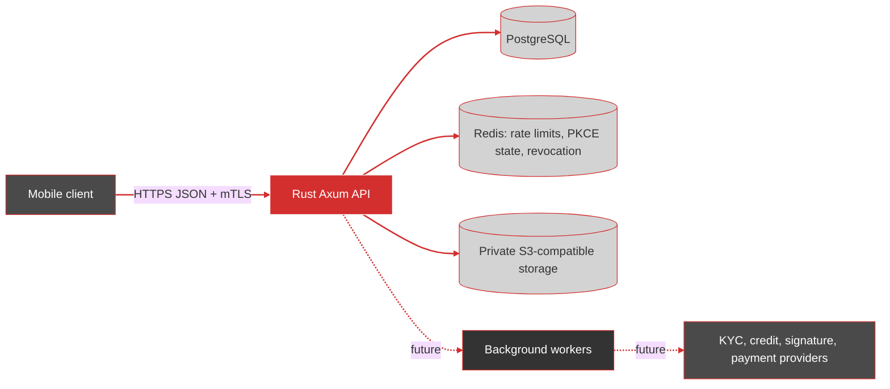
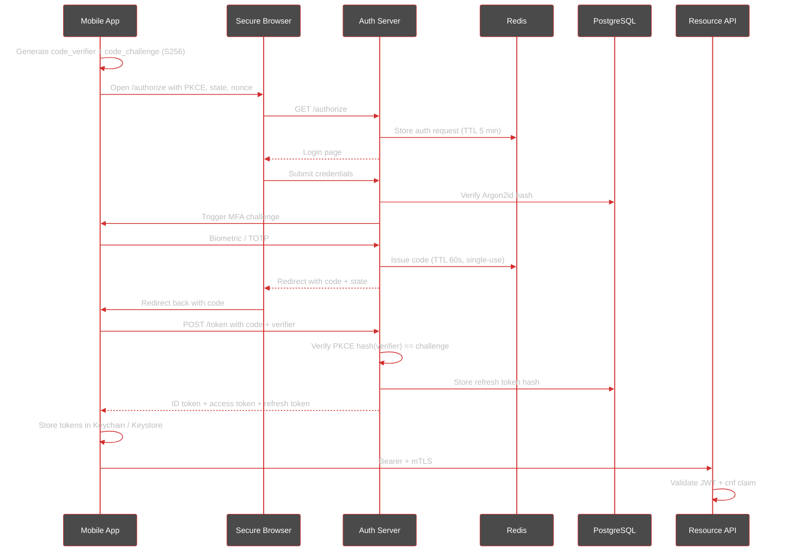

# Rho Studio Fintech Backend Architecture

## Purpose and Status

This document is the short entry point to the backend architecture. It separates
the capabilities in the running Rust service from the target lending design.
The detailed target model and delivery backlog are in [DevPlan.md](DevPlan.md);
account, loan, and payment rules are in [banking-domain.md](banking-domain.md).

| Area | Current implementation | Target |
| --- | --- | --- |
| HTTP API | Health/version, authentication/session, consent | Customer, account, loan, and payment APIs |
| Identity	| Custom HS256 JWT, Argon2id, refresh-token rotation with reuse detection | OIDC + OAuth 2.0 + PKCE, sender-constrained tokens, mTLS, FAPI-aligned|
| Domain | Consent transitions and event mapping | Separate identity, onboarding, account, lending, servicing, and ledger policies |
| Persistence | PostgreSQL migrations and current auth/consent queries | Transactional domain writes, durable audit/outbox, rebuildable projections |
| Integrations | Redis rate limits and S3-compatible storage | KYC, credit, signature, payment-rail, and notification adapters |
| Money movement | Not implemented | Sandbox-first, idempotent and reconciled before any live rail |

The schema contains account, loan, event, and payment-rail tables, but schema
presence is not an implemented API or a production-ready financial workflow.
Do not treat any target endpoint or lifecycle in the design docs as currently
available.

The identity layer currently uses a custom HS256 JWT implementation with Argon2id password hashing and refresh-token rotation with reuse detection. The target architecture migrates this to an OIDC + OAuth 2.0 authorization server with PKCE, sender-constrained tokens, and FAPI alignment. The migration is planned as part of the identity Feature (F2) in DevPlan.md.

## Runtime Topology

The diagrams use the Rho Studio palette defined in [DevPlan.md](DevPlan.md):
Rho red `#D32F2F`, slate `#4A4A4A`, charcoal `#333333`, light gray `#D3D3D3`,
and white `#FFFFFF`.

The API is a Rust modular monolith. HTTP handlers own transport concerns and delegate business rules to `src/domain`; database, Redis, and storage code stay behind infrastructure modules. Provider calls and financial workflows belong in application services/adapters, not in route handlers. Redis is disposable and must never be the authority for balances or settled payments.

## Shared Infrastructure Types

Two types underpin every handler and their design is in progress.

**`AppState`** composes the four long-lived dependencies — `PgPool`, Redis `ConnectionManager`, `Arc<dyn ObjectStorage>`, and `Arc<AppConfig>` — into a single `Clone` struct that Axum moves into each request. Every field is a cheap handle or an `Arc`, so `Clone` refcounts rather than copies. `AppState` has no interior mutability: each dependency is either internally synchronized (pool, Redis manager) or immutable (config, storage trait object). A type-level assertion pins the `Clone + Send + Sync + 'static` bounds so a future field that breaks them fails at the definition site rather than inside the router's type inference.

**`AppError`** implements a two-message model that is the primary defense against information disclosure:

- The internal message (`thiserror`'s `#[error("...")]`) carries full detail for `tracing::error!` and never leaves the process.
- The public message (`public_message()`) is a `&'static str` sent in the JSON body. The `&'static str` return type is deliberate — it forces the message to be a compile-time constant, so no instance-specific data (a user email, a SQL state, a provider error string) can be interpolated into the response.

Every variant maps to a stable HTTP status and a machine-readable `code()` string. Those codes are part of the public API contract. Rate-limited responses additionally emit `Retry-After`. All 5xx responses return the generic public message; the detailed error is logged server-side only.

## Authentication and Authorization Architecture

### Target standard

Use **OpenID Connect (OIDC)** on top of **OAuth 2.0** for authentication and authorization. The Authorization Code Flow with PKCE (Proof Key for Code Exchange) is mandatory for native mobile clients. Implicit flow and Resource Owner Password Credentials (ROPC) are prohibited.

### Token Model

| Token | Lifetime implementation | Storage | Purpose | 
| --- | --- | --- | --- |
| Access token | ≤ 15 minutes | Client memory only | Authorizes API calls. JWT signed with ES256 or PS256. |
| Refresh token | ≤ 30 days, absolute session cap ≤ 90 days | Client secure storage (iOS Keychain / Android Keystore) | Obtains new access tokens. Rotated on every use, single-use. |
| ID token | Same as access token | Client memory only | Proves user identity. JWT with sub, email, nonce claims. |
| Authorization code | ≤ 60 seconds | Redis (server-side) | Single-use, bound to ``client_id``, ``redirect_uri``, and PKCE challenge. |

### Login flow (mobile client)

### Token refresh and reuse detection

Refresh tokens rotate on every use. A previously-used refresh token presented again revokes the entire token family and **emits a security audit event**. Refresh tokens are stored hashed (SHA-256) in PostgreSQL, never plaintext. They are bound to ``device_id`` and, when mTLS is enabled, to the client certificate thumbprint.

### Revocation

``POST /revoke`` invalidates the refresh token and adds the access token's jti to a Redis revocation list. Access tokens are short-lived (≤ 15 minutes) so the revocation list only needs to cover that window.

### MFA and biometrics

Biometric unlock on the device (Face ID / Touch ID / BiometricPrompt) unlocks secure storage. It is not a replacement for server-side MFA.

MFA is required for: first login on a new device, high-value transactions, password change, and refresh token issuance when device trust is low.

### mTLS and FAPI alignment

Mobile clients present a client certificate issued at app install or device binding time. The certificate is stored in the platform's hardware-backed keystore and is revocable server-side. Access tokens include a ``cnf`` (confirmation) claim with the certificate thumbprint — sender-constrained tokens. Resource APIs verify that ``cnf.x5t#S256`` matches the presented certificate.

FAPI-aligned rules applied to the authorization server:

- TLS 1.3 only on FAPI endpoints. No TLS 1.2, no fallback.
- Mandatory PKCE (S256). Plain PKCE is rejected.
- No implicit flow, no ROPC.
- Sender-constrained tokens via mTLS or DPoP.
- Access token lifetime ≤ 15 minutes.
- Refresh token rotation with reuse detection.
- Strict redirect URI matching (exact string, no wildcards).
- ``nonce`` required in OIDC requests. ``state`` required and validated.
- ID token signing with ES256 or PS256. No ``none``, no HS256 for public clients.
- ``iss`` parameter on authorization requests to prevent mix-up attacks.

### Secure token storage

Tokens are never stored in UserDefaults, plain SharedPreferences, files, or logs. Access tokens may live in memory; refresh tokens must be persisted in secure storage. Tokens are wiped on logout, remote revoke signal, root/jailbreak detection, or biometric enrollment change.

| Platform | Storage  | Rules  | 
| --- | --- | --- | 
| iOS |  Keychain (kSecAttrAccessibleWhenUnlockedThisDeviceOnly) |  Optional Secure Enclave for keys. Biometric-gated item access. | 
| Android | Keystore + EncryptedSharedPreferences  |  StrongBox where available. Hardware-backed keys. | 

### Authentication business rules

**BR-A1 — Authentication**. All user authentication must go through OIDC Authorization Code Flow with PKCE (S256). Implicit flow, ROPC, and plain PKCE are rejected. ``state`` and ``nonce`` must be present, random (≥ 128 bits), and validated. Authorization codes are single-use, expire in ≤ 60 seconds, and are bound to ``client_id``, ``redirect_uri``, and PKCE challenge. Redirect URIs must match the registered value exactly.

**BR-A2 — MFA**. MFA is mandatory for: first login on a new device, high-value transactions, password change, and low-trust refresh. Supported second factors: WebAuthn/passkeys (preferred), TOTP, push. SMS OTP is fallback only, rate-limited and risk-scored. Recovery codes are single-use, generated in a set of 10, hashed at rest.

**BR-A3 — Tokens**. Access tokens are JWTs signed with ES256 or PS256, lifetime ≤ 15 minutes. Refresh token lifetime ≤ 30 days; absolute session cap ≤ 90 days. Refresh tokens rotate on every use, are single-use, and are bound to ``device_id`` and (if mTLS) the client cert thumbprint. Reuse revokes the entire token family and emits an audit event. Revocation invalidates refresh tokens immediately and adds ``jti`` to the revocation list for access tokens.

**BR-A4 — Device and transport**. All traffic uses TLS 1.3 with a modern cipher suite. Mobile clients present a valid client certificate (mTLS) to reach FAPI endpoints. Client certificates are issued per-install, stored in hardware-backed keystore, and revocable server-side. Android apps pass Play Integrity; iOS apps pass App Attest before first token issuance. Rooted/jailbroken devices are flagged; high-risk operations are blocked or step-up authenticated.

**BR-A5 — Data protection**. Passwords are hashed with Argon2id (memory ≥ 64 MB, iterations ≥ 3, parallelism ≥ 1). Refresh tokens, recovery codes, and authorization codes are stored hashed. TOTP secrets are encrypted with AES-GCM using keys from KMS/HSM. PII is encrypted at rest. Logs never contain tokens, passwords, OTPs, or full PII. Audit log is append-only; no UPDATE/DELETE permitted.

**BR-A6 — Rate limiting**. Login attempts: max 5 failures per user per 15 minutes → temporary lock. IP-based rate limits on ``/authorize``, ``/token``, ``/mfa/*`` via Redis. OTP/TOTP: max 5 verifications per code, max 10 sends per hour per user. Device registration: max 3 devices per user per 30 days without support intervention. Suspicious geolocation or ASN change on refresh forces re-authentication.

**BR-A7 — Consent and scopes**. Every scope must be explicitly granted by the user and recorded in ``consents``. Resource APIs enforce scope AND consent before returning data. Consent revocation propagates to refresh tokens within 60 seconds. High-risk scopes (``payments:write``, ``transfers:write``) require fresh MFA (step-up) per session.

**BR-A8 — Operational**. Signing keys rotate at least every 90 days; JWKS publishes both current and next key. All auth events are logged to ``audit_log`` with a correlation ID. All services expose ``/healthz`` and ``/readyz``. Secrets come from environment-injected secrets (Docker secrets / Vault), never from code or images. Container images run as non-root, read-only filesystem, no shell in production image. Dependency scanning and ``cargo audit`` run in CI.

## Financial Safety Boundaries

- The authenticated user identity is derived from the validated session. A
	request-supplied customer or account ID is only a resource selector and must
	still pass server-side ownership checks.
- Account balances, loan status, and payment settlement are server-owned facts.
	Clients may submit commands, but cannot set authoritative balances, pricing,
	underwriting decisions, or final payment outcomes.
- Financial commands must be retry-safe. Persist an idempotency key and request
	hash with the command result; same key/same request returns the prior result,
	while same key/different request conflicts.
- A provider acknowledgement is not settlement. A confirmed financial event,
	audit record, ledger posting, and outbox event must be transactionally
	consistent. Corrections use compensating entries rather than editing posted
	financial history.
- Money must use exact decimal/integer representations and explicit currency;
	never use binary floating point. Resolve the schema's `NUMERIC` versus
	target minor-unit representation before implementing financial commands.
- Webhooks are untrusted until signature, timestamp/replay, and event
	de-duplication checks pass. Reconciliation remains necessary even with
	provider idempotency.

## Persistence and Ownership

PostgreSQL is the durable system of record. Each domain owns its state changes;
cross-domain behavior is coordinated through application commands and durable
events. Read projections are rebuildable and must not become a second source of
financial truth. Existing event-store, outbox, idempotency, and RLS migrations
are schema groundwork; the current runtime does not implement their complete
processing or transaction context.

Use forward-only migrations. Never rewrite a migration already applied to an
environment. Before retiring old environment data, inventory rows and
dependencies, approve retention/deletion, verify backups, and rehearse a
scoped purge separately from application deployment.

## Deployment

The Compose stack is for local development only. It publishes the API on `8080`, binds PostgreSQL and the RustFS console to host loopback, and keeps Redis and the S3 API on the Compose network. Production requires a TLS edge, private data services, managed secrets/keys, least-privilege identities, backups with restore exercises, monitoring, and an approved operating model. See [deployment-network.md](deployment-network.md) and the production gates in [DevPlan.md](DevPlan.md).

`AppConfig` reads a typed environment (`DEV`, `TEST`, `PROD`) with per-environment validation. The boot sequence is: load config → connect to Postgres → run migrations → connect to Redis → connect to storage → build `AppState` → build router → serve. If any dependency fails to initialize, the process exits before serving traffic — there is no partial-boot state.

## Domain Map

| Context | Owns | Current status |
| --- | --- | --- |
| Identity and sessions | Credentials, refresh-token families, authentication | Delivered: self-service signup, login, refresh, logout, logout-all, me. HS256 JWTs, Argon2id, refresh rotation with reuse detection, per-request session-liveness check. Target: migrate to OIDC + OAuth 2.0 + PKCE. P0 gaps: email verification, password reset, ``kid``-based key rotation. |
| Consent | Versioned notices and append-only consent evidence | Delivered: versioned notices with SHA-256 content hash, immutable once published; append-only events with trigger-enforced immutability. Notices are not seeded — no migration, CLI, or admin endpoint populates `consent_notices`. |
| Onboarding and KYC | Verification cases, provider references, screening outcomes | Schema and handler exist; route not registered in `build_app`. No provider integration. |
| Customer accounts | Account lifecycle, holds, available funds, account history | Schema only. No account routes, no ledger, no `ledger_entries` table. |
| Lending | Applications, decisions, offers, loans, schedules | Schema/design only. No lending routes. |
| Payments and servicing | Transfers, repayment instructions, settlement, allocation | Schema/design only. No payment routes or provider integration. |
| Accounting and reconciliation | Balanced journals, settlement matching, corrections | Design/schema groundwork only. No posting engine. |

---
**[Rho.Studio®](https://rho.studio/) - Engineering Department** - Contact [alexis.tercero@rho.studio](mailto:alexis.tercero@rho.studio)